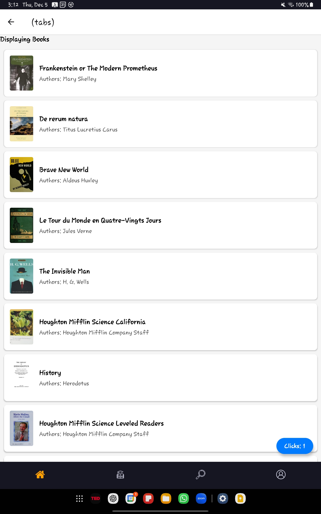
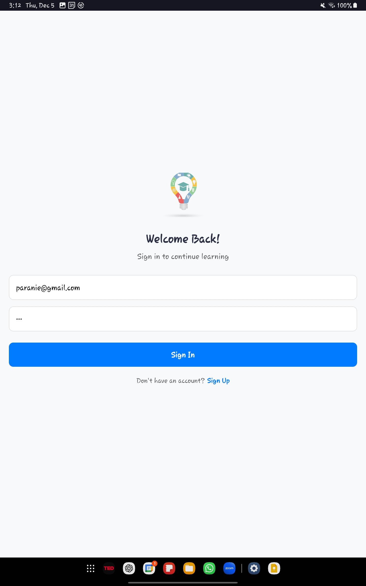
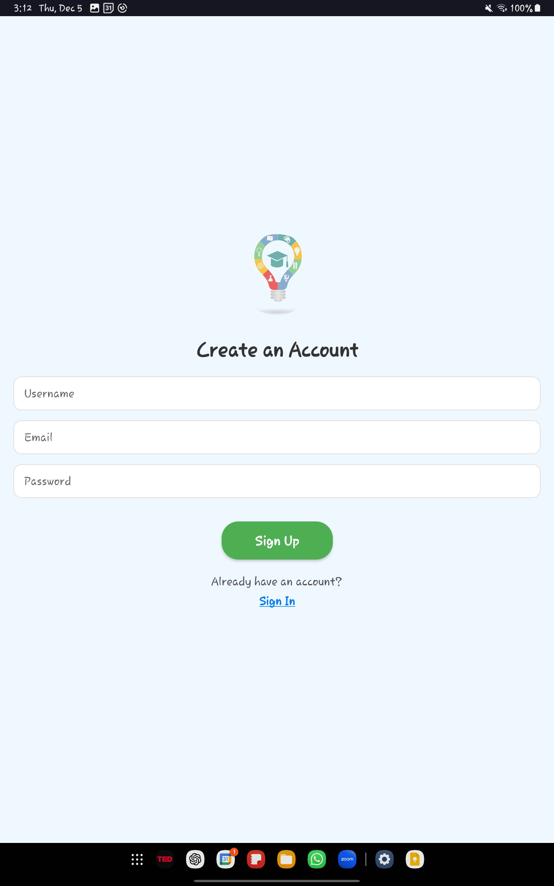
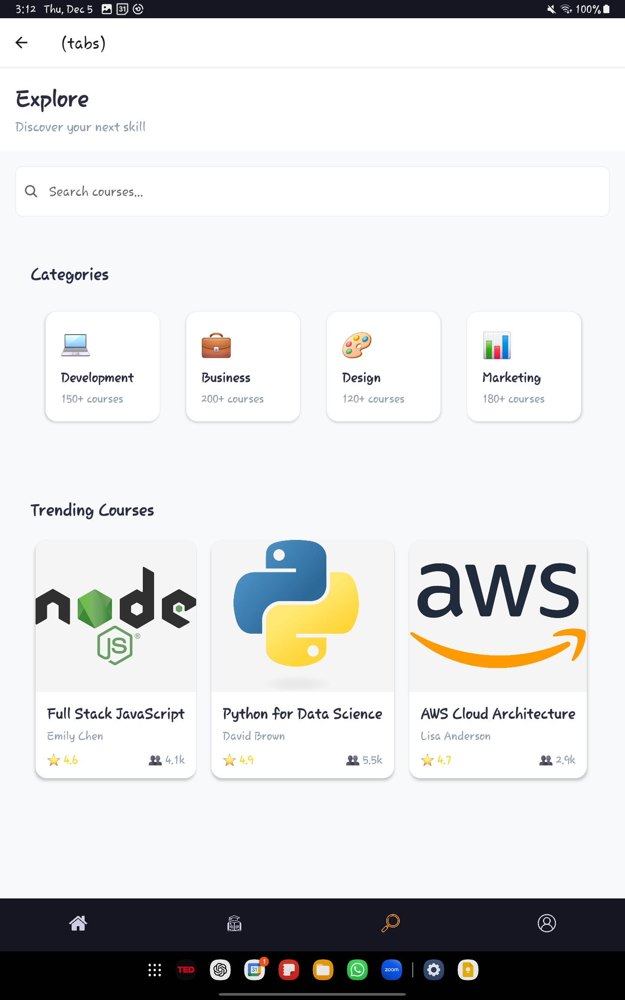
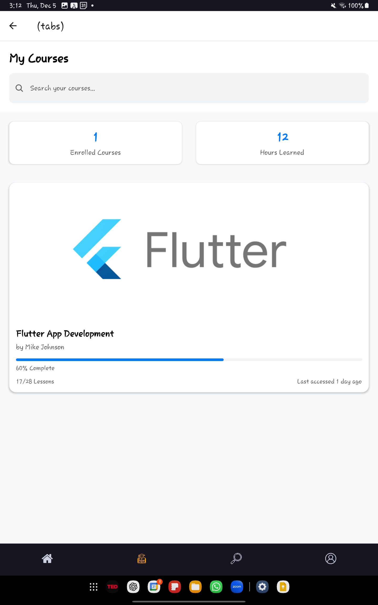
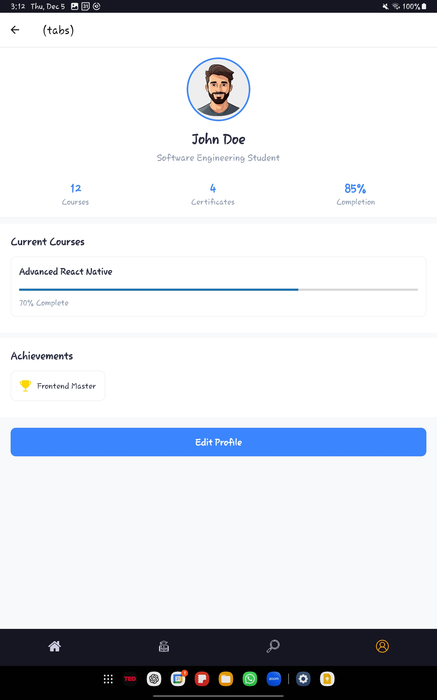
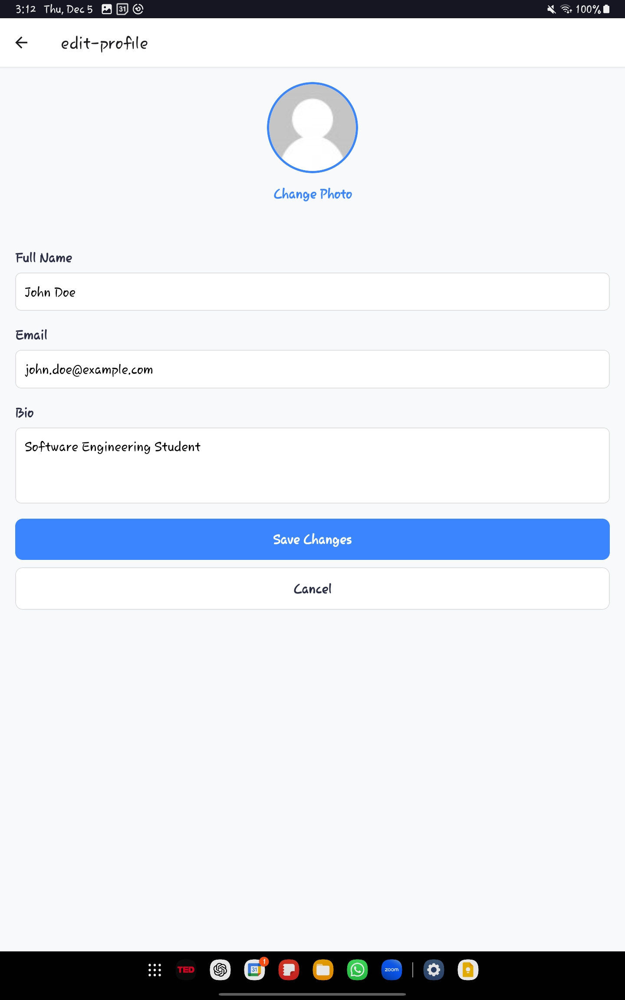

# 🧠 BrainBox - Learning App

BrainBox is a modern, intuitive React Native learning application built with Expo. It provides a comprehensive platform for users to discover, enroll in, and manage their learning courses with a beautiful and user-friendly interface.

## 📱 Features

- **User Authentication**: Secure sign-in and sign-up functionality
- **Course Management**: Browse, explore, and manage your learning courses
- **Profile Management**: Edit and customize your user profile
- **Responsive Design**: Optimized for both iOS and Android platforms
- **Modern UI/UX**: Clean, intuitive interface with smooth navigation

## 🛠️ Tech Stack

- **Framework**: React Native with Expo
- **Navigation**: Expo Router for file-based routing
- **State Management**: Zustand for lightweight state management
- **Form Handling**: React Hook Form for efficient form management
- **Platform**: Cross-platform (iOS, Android, Web)

## 📦 Dependencies

- Expo SDK 52
- React Native 0.76.3
- React 18.3.1
- Expo Router 4.0.11
- Zustand 5.0.2
- React Hook Form 7.53.2

## 🚀 Getting Started

### Prerequisites

- Node.js (v16 or higher)
- npm or yarn
- Expo CLI
- iOS Simulator (for iOS development)
- Android Studio (for Android development)

### Installation

1. Clone the repository:
```bash
git clone <repository-url>
cd BrainBox
```

2. Install dependencies:
```bash
npm install
```

3. Start the development server:
```bash
npm start
```

4. Run on specific platforms:
```bash
# iOS
npm run ios

# Android
npm run android

# Web
npm run web
```

## 📱 App Screenshots

### Welcome Screen

*Beautiful welcome screen with the BrainBox logo and call-to-action*

### Authentication Screens

*Clean and intuitive sign-in interface*


*User-friendly registration form*

### Main App Screens

*Main dashboard showing course recommendations and quick access*


*Discover new courses and learning opportunities*


*Manage your enrolled courses and track progress*


*User profile with personal information and settings*


*Edit and customize your profile information*

## 🎥 Demo Video

Watch the complete app demonstration:

https://github.com/user-attachments/assets/214145R_ReactNative_app.mp4

*This video showcases the full user journey from authentication to course management*

## 🏗️ Project Structure

```
BrainBox/
├── app/                    # Main application code
│   ├── (auth)/            # Authentication screens
│   │   ├── sign-in.jsx    # Sign in screen
│   │   └── sign-up.jsx    # Sign up screen
│   ├── (tabs)/            # Tab-based navigation screens
│   │   ├── home.jsx       # Home dashboard
│   │   ├── explore.jsx    # Course exploration
│   │   ├── my-courses.jsx # User's courses
│   │   └── profile.jsx    # User profile
│   ├── store/             # State management
│   │   └── courseStore.js # Course-related state
│   └── _layout.jsx        # Root layout
├── assets/                # Static assets
│   ├── images/           # App images and logos
│   └── icons/            # Tab and UI icons
├── constants/            # App constants and configurations
└── screenshots/          # App screenshots for documentation
```

## 🎨 Design Features

- **Dark Theme**: Modern dark interface with orange accent colors
- **Tab Navigation**: Intuitive bottom tab navigation
- **Responsive Layout**: Adapts to different screen sizes
- **Smooth Animations**: Enhanced user experience with smooth transitions
- **Custom Icons**: Unique iconography for better visual hierarchy

## 🔧 Configuration

The app is configured through `app.json` with:
- App name: "BrainBox"
- Version: 1.0.0
- Orientation: Portrait
- Custom splash screen and icons
- Cross-platform support (iOS, Android, Web)

## 📱 Supported Platforms

- ✅ iOS (iPhone & iPad)
- ✅ Android (Phone & Tablet)
- ✅ Web (Progressive Web App)

## 🤝 Contributing

1. Fork the repository
2. Create a feature branch (`git checkout -b feature/AmazingFeature`)
3. Commit your changes (`git commit -m 'Add some AmazingFeature'`)
4. Push to the branch (`git push origin feature/AmazingFeature`)
5. Open a Pull Request

## 📄 License

This project is licensed under the MIT License - see the LICENSE file for details.

## 👨‍💻 Developer
Name: Paranietharan P.
Index No: 214145R

